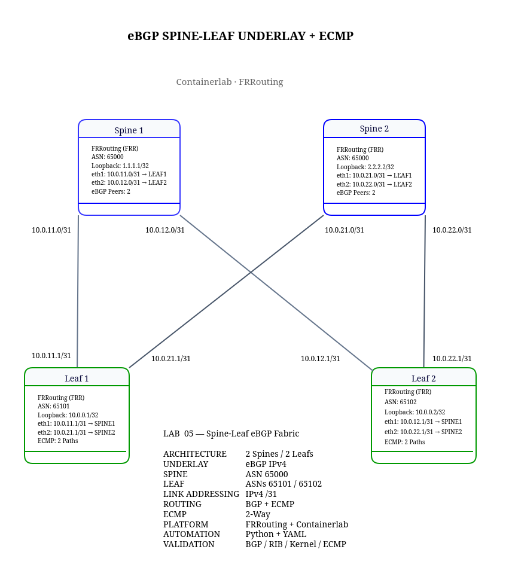

# Lab 05 — Spine-Leaf eBGP Fabric with ECMP

## Overview

This lab demonstrates a four-node Spine-Leaf underlay fabric using FRRouting (FRR), Docker, and Containerlab.

The objective is to establish redundant Layer 3 connectivity between Leaf routers through two Spine routers using external BGP (eBGP) and Equal-Cost Multi-Path (ECMP).

The project follows two stages:

- **v1 — Manual configuration, routing verification, and troubleshooting**
- **v2 — Automated fabric health validation using Python and YAML**

## Network Topology

The fabric consists of two Spine routers and two Leaf routers.



**Physical connections:**

| Spine | Interface | Leaf | Interface | Subnet |
|---|---|---|---|---|
| Spine1 | eth1 | Leaf1 | eth1 | 10.0.11.0/31 |
| Spine1 | eth2 | Leaf2 | eth1 | 10.0.12.0/31 |
| Spine2 | eth1 | Leaf1 | eth2 | 10.0.21.0/31 |
| Spine2 | eth2 | Leaf2 | eth2 | 10.0.22.0/31 |

There is no direct Leaf-to-Leaf connection. Traffic between Leafs traverses one of the Spine routers.

## Addressing Plan

| Device | ASN | Loopback |
|---|---|---|
| Spine1 | 65000 | 1.1.1.1/32 |
| Spine2 | 65000 | 2.2.2.2/32 |
| Leaf1 | 65101 | 10.0.0.1/32 |
| Leaf2 | 65102 | 10.0.0.2/32 |

## Technologies

- FRRouting
- Docker
- Containerlab
- Linux networking
- eBGP underlay routing
- ECMP
- Python automation

## Deployment

Deploy the topology:

```bash
sudo containerlab deploy -t topology.clab.yml
```

Inspect the running containers:

```bash
sudo containerlab inspect -t topology.clab.yml
```

## Manual BGP Verification

Check the eBGP sessions on Leaf1:

```bash
docker exec clab-frr-spine-leaf-leaf1 \
  vtysh -c "show bgp ipv4 unicast summary"
```

Expected result: two established eBGP sessions with Spine1 and Spine2.

## ECMP Verification

Check FRRouting's routing table:

```bash
docker exec clab-frr-spine-leaf-leaf1 \
  vtysh -c "show ip route 10.0.0.2/32"
```

Expected nexthops:

```text
10.0.11.0 via eth1
10.0.21.0 via eth2
```

Check the Linux forwarding table:

```bash
docker exec clab-frr-spine-leaf-leaf1 \
  ip -4 route show 10.0.0.2/32
```

The kernel should contain both ECMP nexthops.

## Troubleshooting

### eBGP Established but Routes Missing

FRRouting may enforce eBGP import/export policy requirements.

For this educational lab, the configuration uses:

```text
no bgp ebgp-requires-policy
```

Production deployments should use explicit routing policies.

### RIB and Kernel Inconsistency

During fault injection, FRRouting reported two ECMP nexthops while the Linux kernel contained only one.

This demonstrated why validating BGP sessions alone is insufficient to confirm the expected forwarding state.

## Progression to Automated Validation

The manual fabric is extended with a Python validation engine that checks:

- eBGP neighbor state and remote ASNs.
- Interface health and addressing.
- Loopback configuration.
- Expected BGP routes.
- FRRouting RIB.
- Linux kernel forwarding state.
- ECMP nexthops.
- RIB-to-kernel consistency.

See [Lab 05 v2 — Automated Fabric Validation](v2-automation/README.md).

## Cleanup

```bash
sudo containerlab destroy -t topology.clab.yml
```

## Author

**NetworkJR7 — Enterprise Networking & Datacenter Automation Labs**
